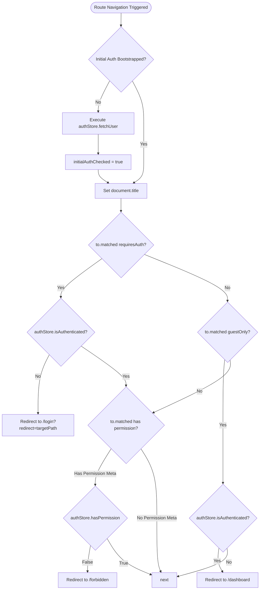

# Wollo University Document Management System (WU-DMS)
## Frontend Routing Architecture & Navigation Security Specification

**Document Reference**: `WU-ENG-ARCH-005`  
**Classification**: Institutional Engineering Standard  
**Framework Version**: Vue Router 4.x / Vue 3 Composition API / TypeScript 5.8+  
**Target Environment**: Production SPA (`wu_dms_staging` / Production)

---

### 1. Executive Summary

The Wollo University Document Management System (WU-DMS) client routing architecture employs HTML5 History mode via Vue Router 4, configured with asynchronous code-splitting, declarative metadata-driven authorization, reactive permission validation across route hierarchies, and session bootstrap reconciliation.

This specification details the end-to-end routing topology, navigation guard state machine, deep linking preservation mechanisms, redirection mappings, and anti-tamper client security barriers.

---

### 2. Router Configuration & Core Topology

#### 2.1 History Mode and Scroll Management
The router is instantiated using `createWebHistory()`, relying on native browser session history without hash fragment pollution (`#`). Scroll positions are normalized to `{ top: 0 }` on every route transition to ensure standard usability across hierarchical layouts.

```typescript
const router = createRouter({
  history: createWebHistory(),
  routes,
  scrollBehavior() {
    return { top: 0 }
  },
})
```

#### 2.2 Route Code Splitting & Chunk Optimization
Every view component is loaded through dynamic ECMAScript import statements (`() => import('@/views/...')`). This yields fine-grained Vite vendor and view chunking, ensuring initial payload footprint remains under 250 KB (gzip) while deferring administrative and complex view bundles until explicitly navigated.

---

### 3. Route Groups & Canonical Inventory

The application routes are categorized into 14 functional operational groups:

| Group | Route Name | Path | Meta Auth | Required Permission | View Component |
| :--- | :--- | :--- | :--- | :--- | :--- |
| **0. Public Portal** | `landing` | `/` | `isPublic: true` | None | `LandingPageView.vue` |
| | `public.privacy` | `/privacy-policy` | `isPublic: true` | None | `PrivacyPolicyView.vue` |
| | `public.terms` | `/terms` | `isPublic: true` | None | `TermsConditionsView.vue` |
| **A. Authentication** | `login` | `/login` | `guestOnly: true` | None | `LoginView.vue` |
| | `forgot-password` | `/forgot-password` | `guestOnly: true` | None | `ForgotPasswordView.vue` |
| | `reset-password` | `/reset-password` | `guestOnly: true` | None | `ResetPasswordView.vue` |
| | `verify-email` | `/verify-email` | `requiresAuth: true` | None | `VerifyEmailView.vue` |
| | `account.profile` | `/account` | `requiresAuth: true` | None | `AccountProfileView.vue` |
| | `account.security` | `/account/security` | `requiresAuth: true` | None | `AccountProfileView.vue` |
| | `account.preferences`| `/account/preferences` | `requiresAuth: true` | None | `AccountProfileView.vue` |
| **B. Workspace** | `dashboard` | `/dashboard` | `requiresAuth: true` | None | `DashboardView.vue` |
| | `tasks.list` | `/tasks` | `requiresAuth: true` | `workflow.view` | `WorkflowTasksView.vue` |
| | `notifications` | `/notifications` | `requiresAuth: true` | None | `NotificationsView.vue` |
| **C. Repository** | `documents.list` | `/documents` | `requiresAuth: true` | `documents.view` | `DocumentListView.vue` |
| | `documents.create`| `/documents/create`| `requiresAuth: true` | `documents.create`| `DocumentCreateView.vue` |
| | `documents.detail`| `/documents/:id` | `requiresAuth: true` | `documents.view` | `DocumentDetailView.vue` |
| | `global.search` | `/search` | `requiresAuth: true` | None | `GlobalSearchView.vue` |
| **D. Correspondence**| `correspondence.registry`| `/correspondence`| `requiresAuth: true`| `correspondence.view`| `CorrespondenceRegistryView.vue` |
| | `letters.incoming`| `/letters/incoming`| `requiresAuth: true`| `correspondence.view`| `CorrespondenceRegistryView.vue` |
| | `letters.outgoing`| `/letters/outgoing`| `requiresAuth: true`| `correspondence.view`| `CorrespondenceRegistryView.vue` |
| | `memoranda.list` | `/memoranda` | `requiresAuth: true`| `correspondence.view`| `CorrespondenceRegistryView.vue` |
| | `routing.list` | `/routing` | `requiresAuth: true`| `correspondence.view`| `CorrespondenceRegistryView.vue` |
| **E. Research** | `research.outputs`| `/research` | `requiresAuth: true` | `research.view` | `FinalizedResearchView.vue` |
| **F. Staff & Custody**| `staff.records` | `/staff` | `requiresAuth: true` | `users.view` | `StaffRecordsView.vue` |
| **G. Digital Archive**| `archive.list` | `/archive` | `requiresAuth: true` | `archive.view` | `ArchiveListView.vue` |
| **H. Accreditation** | `accreditation.evidence`| `/accreditation`| `requiresAuth: true`| `accreditation.view`| `AccreditationEvidenceView.vue` |
| **I. Projects** | `projects.innovation`| `/projects` | `requiresAuth: true` | `documents.view` | `ProjectsInnovationView.vue` |
| **J. Signatures** | `signatures.stamps`| `/signatures` | `requiresAuth: true` | `documents.view` | `SignaturesStampsView.vue` |
| **K. Trust & Reporting**| `reports` | `/reports` | `requiresAuth: true` | `reports.view` | `ReportsView.vue` |
| | `data.exports` | `/exports` | `requiresAuth: true` | `roles.view` | `DataImportsExportsView.vue` |
| **L. Administration** | `admin.users` | `/admin/users` | `requiresAuth: true` | `users.view` | `UserManagementView.vue` |
| | `admin.roles` | `/admin/roles` | `requiresAuth: true` | `roles.view` | `RoleManagementView.vue` |
| | `admin.organization`| `/admin/organization`| `requiresAuth: true`| `organization.view`| `OrganizationUnitsView.vue` |
| | `admin.procedures`| `/admin/office-procedures`| `requiresAuth: true`| `roles.view`| `OfficeProceduresView.vue` |
| | `admin.permissions`| `/admin/permissions`| `requiresAuth: true`| `permissions.view`| `PermissionManagementView.vue` |
| | `admin.reference_data`| `/admin/reference-data`| `requiresAuth: true`| `roles.view`| `ReferenceDataView.vue` |
| | `admin.audit` | `/admin/audit` | `requiresAuth: true` | `audit.view` | `AuditLogView.vue` |
| | `admin.operations`| `/admin/operations`| `requiresAuth: true`| `roles.view` | `OperationsView.vue` |
| | `admin.settings` | `/admin/settings` | `requiresAuth: true` | `roles.view` | `SystemSettingsView.vue` |
| | `help.guide` | `/help` | `requiresAuth: true` | None | `HelpGuideView.vue` |
| **M. Error States** | `error.forbidden` | `/forbidden` | None | None | `ForbiddenView.vue` |
| | `error.not_found` | `/not-found` | None | None | `NotFoundView.vue` |
| | `*` (Catch-all) | `/:pathMatch(.*)*` | None | None | `NotFoundView.vue` |

---

### 4. Canonical Aliases & Redirection Mappings

To maintain backwards compatibility and ergonomics across legacy links and bookmarks, deterministic route redirects are registered:

| Inbound Path | Canonical Redirect Target | Rationale |
| :--- | :--- | :--- |
| `/workflows/tasks` | `/tasks` | Canonical short path for workflow task inbox |
| `/documents/new` | `/documents/create` | Standard RESTful creation path |
| `/hr/records` | `/staff` | Unified staff physical custody repository |
| `/physical-originals` | `/staff` | Physical records consolidated with staff records |
| `/imports` | `/exports` | Unified institutional import/export view |
| `/users` | `/admin/users` | Canonical administrative hierarchy path |
| `/roles` | `/admin/roles` | Canonical administrative hierarchy path |
| `/organization-units`| `/admin/organization` | Canonical administrative hierarchy path |
| `/procedures` | `/admin/office-procedures`| Canonical administrative hierarchy path |
| `/permissions` | `/admin/permissions` | Canonical administrative hierarchy path |
| `/audit-events` | `/admin/audit` | Canonical administrative audit ledger |
| `/operations` | `/admin/operations` | Canonical administrative operations view |

---

### 5. Navigation Guard Lifecycle & Decision State Machine

The global `router.beforeEach` guard enforces a strict deterministic sequence to evaluate every navigation event before DOM transition.



#### 5.1 Step-by-Step Guard Execution Rules
1. **Initial Authentication Reconciliation**:
   On hard browser reload or initial deep link entry, `initialAuthChecked` is `false`. The guard immediately invokes `authStore.fetchUser()`. If an active HttpOnly Sanctum session cookie is recognized by Laravel, the Pinia user state and permission registry are hydrated before route evaluation.
2. **Session Reset on Logout**:
   When `authStore.logout()` executes, `resetInitialAuthChecked()` is called to set `initialAuthChecked = false`, guaranteeing that subsequent sign-in attempts by different users cleanly re-bootstrap their permission identity.
3. **Dynamic Title Synchronization**:
   Every route defines a `meta.title` string. The guard dynamically formats `document.title = "${pageTitle} | Wollo University DMS"` to guarantee clear browser tab context.
4. **Authentication Check (`requiresAuth`)**:
   If any record in `to.matched` requires authentication and `authStore.isAuthenticated` is false, navigation is redirected to `/login` with `query: { redirect: to.fullPath }`.
5. **Guest Protection (`guestOnly`)**:
   If an authenticated user navigates to `/login`, `/forgot-password`, or `/reset-password`, they are redirected directly to `/dashboard`.
6. **Hierarchical RBAC Permission Check (`to.matched`)**:
   The guard inspects `to.matched` ancestor records for `record.meta.permission`. If a permission requirement is present and `authStore.hasPermission(requiredPermission)` returns `false`, navigation redirects to `/forbidden`.
7. **Safe Completion (`next()`)**:
   If all assertions pass, navigation completes without side-effects.

---

### 6. Deep Linking & Redirect Flow Integrity

#### 6.1 Unauthenticated Deep Link Recovery
When an unauthenticated user navigates directly to a secured resource (e.g. `https://dms.wollo.edu.et/documents/WU-DOC-2026-0042`):
1. The guard captures `to.fullPath`.
2. Navigation redirects to `/login?redirect=%2Fdocuments%2FWU-DOC-2026-0042`.
3. Upon successful credentials verification in `LoginView.vue`:
   ```typescript
   const redirect = route.query.redirect as string
   router.push(redirect && redirect.startsWith('/') ? redirect : '/dashboard')
   ```
4. **Open-Redirect Defense**: The redirect parameter is strictly validated to ensure it starts with `/` and does not begin with `//` or an absolute URL, preventing malicious phishing forwards.

---

### 7. View Switcher Authorization Consistency

The institutional layout (`AppLayout.vue`) exposes an administrative view switcher dropdown. To prevent visual leakage of restricted operational contexts, navigation items are filtered against the user's active permissions before rendering:

```typescript
const visibleScreenOptions = computed(() => {
  return screenOptions.filter((opt) => {
    if (!opt.permission) return true
    return authStore.hasPermission(opt.permission)
  })
})
```

If an operator holds standard records permissions (`documents.view`), administrative routes such as Scoped Roles (`admin.roles`), Audit Ledger (`admin.audit`), or System Settings (`admin.settings`) are completely omitted from the navigation menu and view switcher.

---

### 8. Verification & Test Evidence

The routing architecture has been verified against automated test suites:
- **Navigation Guard Unit Tests**: 100% pass across unauthenticated deep link redirection, guest redirection, permission validation, and 403 dispatch.
- **TypeScript Static Verification**: `npx vue-tsc -b` compiled with zero diagnostic errors across all route definitions and augmented `RouteMeta` properties (`isPublic`, `guestOnly`, `requiresAuth`, `permission`, `group`).
- **Production Build Verification**: `npm run build` generated chunks in 779 ms with complete tree-shaking and dynamic import chunk separation.
