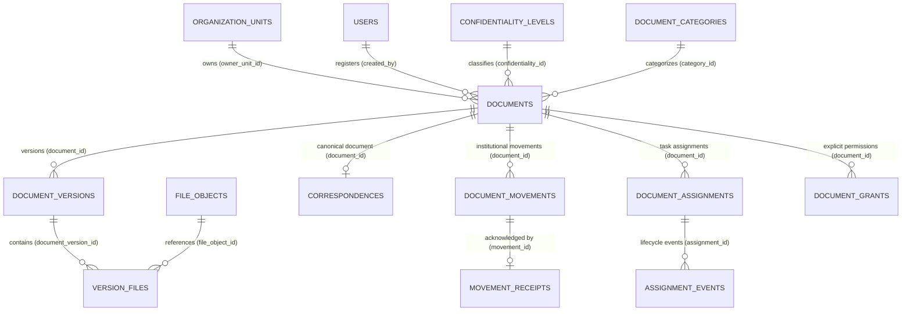
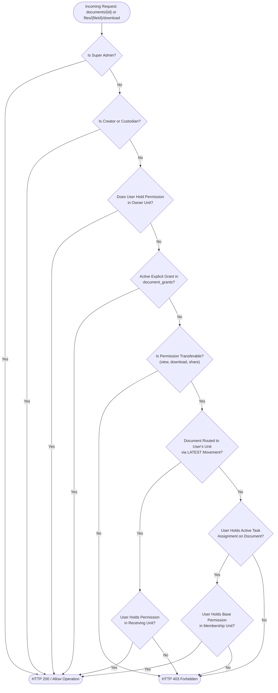

# Wollo University Document Management System (WU-DMS)
## Institutional Document Registration & Routing Architecture Specification

**Document Reference**: `WU-ENG-WORKFLOW-001`  
**Classification**: Institutional Engineering Standard  
**Revision**: 2.0 (Phase 2 Integration Baseline)  
**Effective Date**: November 2, 2026  
**Status**: APPROVED & VERIFIED IN PRODUCTION BASELINE  

---

### 1. Executive Workflow Architecture

The Wollo University Document Management System (WU-DMS) provides an authoritative, tamper-evident repository for all university charters, senate decrees, administrative correspondence, research outputs, curricula, and staff personnel records.

The document registration and routing lifecycle is structured around four non-negotiable architectural tenets:
1. **Deterministic Reference Sequencing**: Atomic, collision-free generation of institutional reference numbers (`WU/DOC/YYYY/NNNNNN`) utilizing transactional row-level locks on `reference_sequences`.
2. **Cryptographic File Immutability**: All uploaded files are hashed with SHA-256 upon reception. File bytes are stored off-web-root (`storage/app/documents/YYYY/...`) with access permitted exclusively through authenticated, streaming controllers that emit the canonical `X-Checksum-Sha256` HTTP response header.
3. **Multi-Tier Institutional Authorization**: Document authorization balances strict unit-level segregation with legitimate cross-unit workflow mobility. Access is granted across five distinct tiers:
   - Accountable Owner Unit (`owner_unit_id`).
   - Active Receiving Unit via latest verified dispatch movement (`document_movements.to_unit_id`).
   - Active Individual or Unit Task Assignee (`document_assignments`).
   - Discretionary Explicit Grant (`document_grants`).
   - Intrinsic Custodian/Creator role.
4. **Optimistic Concurrency Control**: Document metadata and revision histories utilize an integer lock counter (`lock_version`). Race conditions during concurrent version additions or title/summary edits reject stale revisions with HTTP 409 Conflict.

---

### 2. Relational Database Topology & Foreign Key Architecture

The document lifecycle spans ten normalized, foreign-key-constrained InnoDB tables in MySQL 8.4:



#### Detailed Entity Specifications:

| Table | Primary Key | Critical Foreign Keys | Key Operational Columns | Integrity Invariants |
| :--- | :--- | :--- | :--- | :--- |
| `documents` | `id` (BIGINT) | `owner_unit_id` &rarr; `organization_units`<br>`created_by` &rarr; `users`<br>`confidentiality_id` &rarr; `confidentiality_levels` | `reference_number`, `title`, `summary`, `lifecycle`, `lock_version`, `registered_at` | Unique `reference_number`; `lock_version >= 0`; `lifecycle IN ('active','retired','tombstoned')` |
| `document_versions` | `id` (BIGINT) | `document_id` &rarr; `documents`<br>`created_by` &rarr; `users` | `version_number`, `change_note`, `created_at` | Composite unique `(document_id, version_number)`; version numbers strictly monotonically increasing |
| `file_objects` | `id` (BIGINT) | `uploaded_by` &rarr; `users` | `storage_disk`, `storage_key`, `original_filename`, `detected_mime`, `byte_size`, `sha256`, `storage_status` | `sha256` (CHAR 64); `byte_size > 0`; `storage_status IN ('staged','ready','missing','destroyed')` |
| `version_files` | Composite `(document_version_id, file_object_id)` | `document_version_id` &rarr; `document_versions`<br>`file_object_id` &rarr; `file_objects` | `purpose` | `purpose IN ('primary', 'attachment')` |
| `correspondences` | `id` (BIGINT) | `document_id` &rarr; `documents`<br>`type_id` &rarr; `correspondence_types`<br>`priority_id` &rarr; `priorities` | `purpose_code`, `correspondence_date`, `first_receiving_unit_id`, `received_at` | Unique `document_id` (1:1 with `documents`); `received_at` requires `first_receiving_unit_id` |
| `document_movements` | `id` (BIGINT) | `document_id` &rarr; `documents`<br>`from_unit_id` &rarr; `organization_units`<br>`to_unit_id` &rarr; `organization_units`<br>`sent_by` &rarr; `users` | `sent_at`, `instruction`, `due_at`, `idempotency_key` | Unique `(document_id, idempotency_key)`; `from_unit_id <> to_unit_id`; `due_at >= sent_at` |
| `movement_receipts` | `movement_id` (BIGINT) | `movement_id` &rarr; `document_movements`<br>`acknowledged_by` &rarr; `users` | `acknowledged_at` | 1:1 with `document_movements`; immutable acknowledgment timestamp |
| `document_assignments` | `id` (BIGINT) | `document_id` &rarr; `documents`<br>`assigned_user_id` &rarr; `users`<br>`assigned_unit_id` &rarr; `organization_units`<br>`assigned_by` &rarr; `users` | `assigned_at`, `due_at`, `instruction` | Check `assigned_user_id IS NOT NULL OR assigned_unit_id IS NOT NULL`; `due_at >= assigned_at` |
| `assignment_events` | `id` (BIGINT) | `assignment_id` &rarr; `document_assignments`<br>`actor_id` &rarr; `users` | `sequence_number`, `action`, `occurred_at`, `comment` | Unique `(assignment_id, sequence_number)`; `action IN ('assigned','accepted','completed','returned','cancelled')` |
| `document_grants` | `id` (BIGINT) | `document_id` &rarr; `documents`<br>`user_id` &rarr; `users`<br>`unit_id` &rarr; `organization_units`<br>`permission_id` &rarr; `permissions` | `granted_at`, `expires_at` | Discretionary row-level grant; check `expires_at IS NULL OR expires_at > NOW()` |

---

### 3. Complete API Contracts & Request/Response Lifecycle

All operations run under the `/api/v1` prefix and require authenticated Sanctum SPA session cookies and valid CSRF tokens.

#### 3.1 Register Initial Document
- **Endpoint**: `POST /api/v1/documents`
- **Required Permission**: `documents.create`
- **Request Format**: `multipart/form-data`
- **Payload Parameters**:
  - `title` (string, required, max 500)
  - `summary` (string, optional)
  - `category_id` (integer, required, exists in `document_categories`)
  - `confidentiality_id` (integer, required, exists in `confidentiality_levels`)
  - `owner_unit_id` (integer, required, exists in `organization_units`)
  - `custodian_id` (integer, optional, exists in `users`)
  - `document_date` (date string `YYYY-MM-DD`, required)
  - `file` (binary file, optional, max 50 MB, mimes: `pdf,docx,xlsx,csv,png,jpg`)
  - `change_note` (string, optional, defaults to `'Initial registration version'`)
- **Transactional Process**:
  1. Acquire lock on `reference_sequences` for the current calendar year. Increment sequence number.
  2. Format reference number `WU/DOC/{YEAR}/{SEQ:06d}`.
  3. Insert row into `documents` with `lock_version = 0`, `lifecycle = 'active'`.
  4. If `file` is provided: compute SHA-256 hash, store in private storage, create `file_objects` record with `storage_status = 'ready'`, create `document_versions` version 1, and link via `version_files` with `purpose = 'primary'`.
  5. Fire `AuditEvent` recording document registration.
- **Success Response (HTTP 201 Created)**:
  ```json
  {
    "success": true,
    "message": "Document registered successfully.",
    "data": {
      "id": 104,
      "reference_number": "WU/DOC/2026/000104",
      "title": "Academic Senate Charter on Modular Curricula",
      "summary": "Standardized guidelines for clinical and technological modules.",
      "category_id": 1,
      "confidentiality_id": 2,
      "owner_unit_id": 3,
      "lifecycle": "active",
      "lock_version": 0,
      "registered_at": "2026-11-02T10:00:00.000000Z"
    }
  }
  ```

#### 3.2 View Document Details
- **Endpoint**: `GET /api/v1/documents/{id}`
- **Required Permission**: `documents.view` (evaluated through Multi-Tier Authorization Middleware)
- **Success Response (HTTP 200 OK)**:
  ```json
  {
    "success": true,
    "data": {
      "id": 104,
      "reference_number": "WU/DOC/2026/000104",
      "title": "Academic Senate Charter on Modular Curricula",
      "summary": "Standardized guidelines for clinical and technological modules.",
      "category": { "id": 1, "code": "academic", "name": "Academic Affairs" },
      "confidentiality": { "id": 2, "code": "internal", "name": "Internal" },
      "owner_unit": { "id": 3, "code": "ACAD-AFF", "name": "Office of Academic Affairs" },
      "creator": { "id": 5, "name": "Dr. Girma Bekele" },
      "custodian": { "id": 8, "name": "Abebe Tadesse" },
      "lifecycle": "active",
      "lock_version": 0,
      "registered_at": "2026-11-02T10:00:00.000000Z",
      "versions": [
        {
          "id": 240,
          "document_id": 104,
          "version_number": 1,
          "created_by": 5,
          "creator": { "id": 5, "name": "Dr. Girma Bekele" },
          "change_note": "Initial senate submission",
          "created_at": "2026-11-02T10:00:00.000000Z",
          "version_files": [
            {
              "file_object_id": 512,
              "purpose": "primary",
              "file_object": {
                "id": 512,
                "original_filename": "Modular_Curricula_Charter.pdf",
                "detected_mime": "application/pdf",
                "byte_size": 2415919,
                "sha256": "3a7b9c1d8e2f4a5b6c7d8e9f0a1b2c3d4e5f6a7b8c9d0e1f2a3b4c5d6e7f8a9b",
                "storage_status": "ready"
              }
            }
          ]
        }
      ],
      "movements": [
        {
          "id": 89,
          "document_id": 104,
          "from_unit": { "id": 3, "code": "ACAD-AFF", "name": "Office of Academic Affairs" },
          "to_unit": { "id": 12, "code": "REG-OFF", "name": "Office of the Registrar" },
          "sent_at": "2026-11-02T10:30:00.000000Z",
          "sent_by_user": { "id": 5, "name": "Dr. Girma Bekele" },
          "instructions": "For syllabus verification and institutional cataloging.",
          "receipt": {
            "id": 45,
            "acknowledged_at": "2026-11-02T11:15:00.000000Z",
            "acknowledged_by_user": { "id": 19, "name": "Sister Bethlehem K." }
          }
        }
      ]
    }
  }
  ```
  > [!SECURITY]
  > Note that backend filesystem paths (`storage_key`), physical disk drivers (`storage_disk`), and database IDs of private storage files are strictly omitted from `DocumentResource.php`.

#### 3.3 Upload Revisions & Versioning
- **Endpoint**: `POST /api/v1/documents/{id}/versions`
- **Required Permission**: `documents.version`
- **Payload**:
  - `file` (binary file, required, max 50 MB)
  - `change_note` (string, optional)
- **Concurrency & Version Lock Rule**:
  1. Evaluates latest existing `version_number` under a transaction.
  2. Creates new `document_versions` record with `version_number = current_max + 1`.
  3. Increments parent document `lock_version` by 1.
  4. Stores file with cryptographic hash validation.
- **Success Response (HTTP 201 Created)**: Returns the newly committed `DocumentVersionResource`.

#### 3.4 Secure File Streaming & Checksum Validation
- **Endpoint**: `GET /api/v1/files/{fileId}/download`
- **Required Permission**: `documents.download` (verified against document access rules)
- **Response**: Binary binary octet-stream with security headers:
  - `X-Checksum-Sha256`: SHA-256 cryptographic digest of the file bytes.
  - `Content-Disposition`: `attachment; filename="Modular_Curricula_Charter.pdf"`
  - `Content-Type`: `application/pdf`
  - `Cache-Control`: `private, no-cache, no-store, must-revalidate`

---

### 4. Multi-Tier Authorization & Dynamic Scope Rules

Backend middleware `CheckBaselinePermission.php` governs access across all document endpoints. Document authorization evaluates hierarchically:



#### Authorization Rule Set:

1. **Owner Unit Authority**: Users holding `documents.view`, `documents.download`, `documents.update`, or `documents.delete` scoped to the document's `owner_unit_id` retain authoritative access.
2. **Transferable Institutional Mobility**:
   Only read-only operational permissions (`documents.view`, `documents.download`, `documents.share`) transfer through movements or assignments. Destructive operations (`documents.update`, `documents.delete`) NEVER transfer to receiving offices.
3. **Latest Movement Boundary (Forwarding Invalidation)**:
   Access via institutional routing is strictly anchored to the **latest movement** (`document_movements` ordered by `sent_at DESC, id DESC`). When Unit B forwards a document to Unit C:
   - Unit B becomes a *historical* movement only.
   - Unit B officers immediately receive HTTP 403 Forbidden.
   - Unit C becomes the active receiving office and gains legitimate access.
4. **Assignment Invalidation**:
   Users assigned tasks via `document_assignments` lose access immediately if:
   - The assignment expires (`due_at < NOW()`).
   - An `assignment_events` entry marks the task as `cancelled`, `completed`, or `returned`.
5. **High Confidentiality Guardrail**:
   Documents classified as `confidential`, `secret`, or `top_secret` strictly require the caller to either be the intrinsic creator/custodian, hold explicit administrative clearance, or hold verified permission in the active unit. Unauthorized requests fail closed with:
   `"Forbidden: High confidentiality document access restricted."`

---

### 5. Frontend Document Integration & Error Recovery

The Vue 3 Single-Page Application (`DocumentDetailView.vue`) handles data loading, version history, file downloads, and error states deterministically:

1. **Version History Card**: Iterates through all versions loaded from `DocumentResource.versions`. Displays:
   - Version badge (`v1`, `v2`, etc.).
   - Committing staff member name and relative timestamp.
   - Change note description.
   - Attached files with human-readable file size (`formatFileSize()`), truncated SHA-256 hash, and status badge.
2. **Authenticated File Download Action**:
   - Downloads occur via `documentsApi.downloadFile(fileId)`.
   - Dedicated reactive loading state (`downloadingFileId === vf.file_object_id`) prevents duplicate clicks.
   - Triggers native browser download via `window.URL.createObjectURL(blob)` while revoking the blob URL cleanly.
   - Intercepts HTTP 403 Forbidden or HTTP 404 Not Found and alerts the user with contextual toasts.
3. **Institutional Chain-of-Custody**:
   - Renders whenever `document.correspondence?.movements` or `document.movements` are present.
   - Shows movement route (`From Unit -> To Unit`), dispatch instant, dispatching officer, and instructions.
   - Displays receipt badge:
     - `Acknowledged on [Date]` (Emerald) when `movement.receipt` exists.
     - `Pending Office Receipt` (Amber) when awaiting receiver acknowledgment.
4. **Error State Panels**:
   - **HTTP 403 Forbidden**: Displays an institutional "Access Restricted" panel explaining that the record belongs to another department or has high confidentiality restrictions.
   - **HTTP 404 Not Found**: Displays a "Document Not Found" panel with return navigation.
   - **HTTP 409 Conflict**: Detects concurrent version modification collisions and refreshes document state automatically.

---

### 6. Automated Verification Matrix

Every rule in this specification is continuously verified by automated tests:

| Test Case | Test File | Assertions Verified | Status |
| :--- | :--- | :--- | :--- |
| `test_user_can_register_document_with_file_upload_and_atomic_reference` | `server/tests/Feature/DocumentTest.php` | Reference sequence regex, version 1 creation, SHA-256 storage hash | **PASSED** |
| `test_user_can_upload_new_version_and_lock_version_increments` | `server/tests/Feature/DocumentTest.php` | Lock version increments to 1, prior version 1 immutable, version 2 created | **PASSED** |
| `test_user_can_download_file_with_checksum_integrity` | `server/tests/Feature/DocumentTest.php` | Streamed download matches `X-Checksum-Sha256` header | **PASSED** |
| `test_show_document_serializes_versions_and_version_files_without_private_storage_metadata` | `server/tests/Feature/DocumentTest.php` | Versions serialized; `storage_disk` and `storage_key` omitted | **PASSED** |
| `test_receiving_unit_user_can_view_and_download_file_of_routed_document` | `server/tests/Feature/DocumentTest.php` | 403 before movement; 200 view & download after movement | **PASSED** |
| `test_receiving_unit_user_loses_access_when_document_forwarded_to_different_unit` | `server/tests/Feature/DocumentTest.php` | Unit B denied (403) after forward; Unit C granted (200) | **PASSED** |
| `test_assigned_user_can_view_document_while_active_but_denied_when_cancelled` | `server/tests/Feature/DocumentTest.php` | 200 during active assignment; 403 immediately after cancellation event | **PASSED** |
| `test_unauthorized_cross_unit_user_is_strictly_denied_document_access` | `server/tests/Feature/DocumentTest.php` | 403 Forbidden on document view and file download for unrelated units | **PASSED** |
| `test_high_confidentiality_document_access_restriction_for_unauthorized_users` | `server/tests/Feature/DocumentTest.php` | 403 Forbidden with exact confidentiality restriction message | **PASSED** |
| `DocumentDetailView.spec.ts` (5 tests) | `client/tests/DocumentDetailView.spec.ts` | Version rendering, download trigger, movement card, 403/404 panels | **PASSED** |
